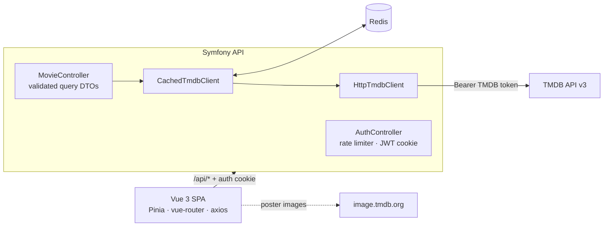

# media-app

[](https://github.com/okarabudka/media-app/actions/workflows/ci.yml)

Movie search on top of [The Movie Database (TMDB)](https://www.themoviedb.org/). A Symfony JSON API proxies and
caches TMDB and handles login; a Vue 3 single-page app shows popular movies, searches as you type and pages through
the results. The TMDB token stays on the server, and the session token never becomes readable by JavaScript.

## Why it exists

It started as a take-home style task: a login-protected app for browsing and searching movies. The goal here is to
solve it the way a production feature would be solved, not just make it work: a clear API contract, security
decisions that are written down, a third-party API that is cached and isolated behind an interface, and tests that
run without network or credentials. The design came first and is kept in [`plan/`](plan/).

## What you get

**A backend that protects the upstream API.** Symfony 8.1 on PHP 8.5. The browser only ever talks to `/api`; Symfony
calls TMDB with the server-side token, caches successful answers in Redis and translates TMDB failures into clear
HTTP errors. Search input is validated before it reaches TMDB.

**Login with a replaceable provider.** `AuthProviderInterface` decides who may log in. The included
`StubAuthProvider` accepts one account from the environment and rejects everything while it is not configured.
A database or OAuth provider replaces it without touching controllers or security config.

**A session that scripts cannot steal.** After login the API sets a JWT (LexikJWTAuthenticationBundle) in an
`httpOnly`, `SameSite=Strict` cookie. Login is rate limited per client and per account.

**A small, tested SPA.** Vue 3 with Pinia, vue-router, axios and Tailwind CSS, built by Vite and served through
Symfony. Search waits for a 400 ms pause and at least two characters; late answers of older searches are dropped.

**Quality checks from the first commit.** PHPUnit unit and functional tests, PHPStan at level max with the Symfony and
PHPUnit extensions (tests included), PHP CS Fixer, container/YAML/Twig lint, ESLint and Vitest. CI runs all of them,
starts the Docker stack for a smoke test and scans the history with gitleaks.

## Architecture



- `src/Auth` — `AuthProviderInterface`, `StubAuthProvider`, the user provider for JWTs and the cookie factory.
- `src/Tmdb` — `TmdbClientInterface`, the HTTP client, the caching decorator (`#[AsDecorator]`) and the response
  mapper that turns TMDB JSON into `MovieDTO` / `MovieListDTO`.
- `src/EventSubscriber` — every error under `/api` becomes an RFC 9457 problem response; no stack traces.
- `assets/` — the Vue app; `tests/frontend/` — its Vitest suites.

## API

| Method | Path                            | Auth | Description                                         |
|--------|---------------------------------|------|-----------------------------------------------------|
| POST   | `/api/auth/login`               | —    | JSON `{username, password}`; sets the auth cookie   |
| POST   | `/api/auth/logout`              | —    | Clears the auth cookie                              |
| GET    | `/api/auth/me`                  | ✓    | `{username}` of the current session                 |
| GET    | `/api/movies?page=`             | ✓    | Popular movies                                      |
| GET    | `/api/movies/search?q=&page=`   | ✓    | Search; `q` 2–100 characters after trimming         |
| GET    | `/api/movies/{id}`              | ✓    | One movie                                           |

`page` is 1–500 (TMDB serves no more). Errors use `application/problem+json`:

| Situation                                   | Status |
|---------------------------------------------|--------|
| Invalid `q` or `page`, malformed login body | 400 (with `violations`) |
| Wrong credentials, missing or expired session | 401  |
| Unknown movie                               | 404    |
| Login body that is not JSON                 | 415    |
| More than 5 login attempts per minute       | 429 (with `Retry-After`) |
| TMDB rejects the token, fails or is unreachable | 502 |
| TMDB rate limit, or `TMDB_API_KEY` not set  | 503    |

## How to use it

Requirements: Docker with Docker Compose, make and openssl.

```bash
git clone https://github.com/okarabudka/media-app.git && cd media-app
make up
```

The first `make up` creates `.env` from `.env.example` with a generated `APP_SECRET` and `JWT_PASSPHRASE`, builds the
images, installs Composer dependencies and generates the JWT key pair in `config/jwt/` (git-ignored). Then fill in
`.env`:

```dotenv
TMDB_API_KEY=<your TMDB API Read Access Token>
# Example values for a local demo only — choose your own.
AUTH_USERNAME=demo
AUTH_PASSWORD=change-me-locally
```

Open http://localhost:8080 and log in. If port 8080 is taken, set `APP_PORT` in `.env` and run `make up` again.
Without `TMDB_API_KEY` login still works and the movie endpoints answer 503 with an explanation.

### Day-to-day work

| Target            | What it does                                                          |
|-------------------|-----------------------------------------------------------------------|
| `make up`         | Create `.env` on first run, start all containers, install, JWT keys   |
| `make down`       | Stop and remove containers                                            |
| `make test`       | PHPUnit (unit + functional, no network, no TMDB token)                |
| `make lint`       | PHP CS Fixer, PHPStan, container/YAML/Twig lint, composer validate    |
| `make check`      | `lint` and `test`, as in CI                                           |
| `make fix`        | Fix code style                                                        |
| `make front-lint` | ESLint                                                                |
| `make front-test` | Vitest                                                                |
| `make build`      | Production build of the frontend into `public/build`                  |
| `make lock`       | Regenerate `package-lock.json` (see below)                            |
| `make help`       | List all targets                                                      |

`bin/smoke-test` checks a running stack end to end (login, session, validation, logout).

### Frontend dependencies

`package.json` pins exact versions and `.npmrc` disables install scripts. `make lock` writes `package-lock.json` in a
`node:22-alpine` container with `npm install --package-lock-only --ignore-scripts --before=<14 days ago>`, so a
release published in the last two weeks is never picked up. Dependabot uses the same 14-day cooldown.

## Security notes

- **TMDB token.** Only in the server environment; sent per request to TMDB and masked in error messages. Neither API
  responses nor the JS bundle contain it.
- **Session cookie.** The JWT is in an `httpOnly` cookie, so an XSS bug cannot read it. It is `SameSite=Strict` and
  `Secure` on HTTPS (or always, with `JWT_COOKIE_SECURE=1`). The API ignores `Authorization` headers.
- **CSRF.** Cookie authentication brings CSRF into scope. `SameSite=Strict` keeps browsers from sending the cookie
  on any cross-site request. Login accepts only `application/json` bodies, which an HTML form cannot send and which
  trigger a CORS preflight from scripts; that blocks login CSRF. CORS allows credentials only for the origins in
  `CORS_ALLOW_ORIGIN`. The API changes no data besides the session itself; if it ever does, add a CSRF token.
- **Logout.** Clears the cookie. A stateless JWT cannot be revoked before it expires (1 hour); a stolen token would
  stay valid until then. Short TTLs or a deny list are the next step if that matters.
- **Brute force.** 5 attempts per minute per client IP and username, 20 per minute per IP, stored in Redis.
- **Fail closed.** No configured account means no login; no TMDB token means a 503, never a stack trace.

## Status

Maintained. Built in November 2026 from the plan in [`plan/PLAN.md`](plan/PLAN.md) and
[`plan/STEPS.md`](plan/STEPS.md); deviations from the plan (cookie instead of `localStorage`, Symfony 8.1 instead of
7.x, no Doctrine) are owner decisions taken before implementation.

## License

MIT, see [LICENSE](LICENSE).
